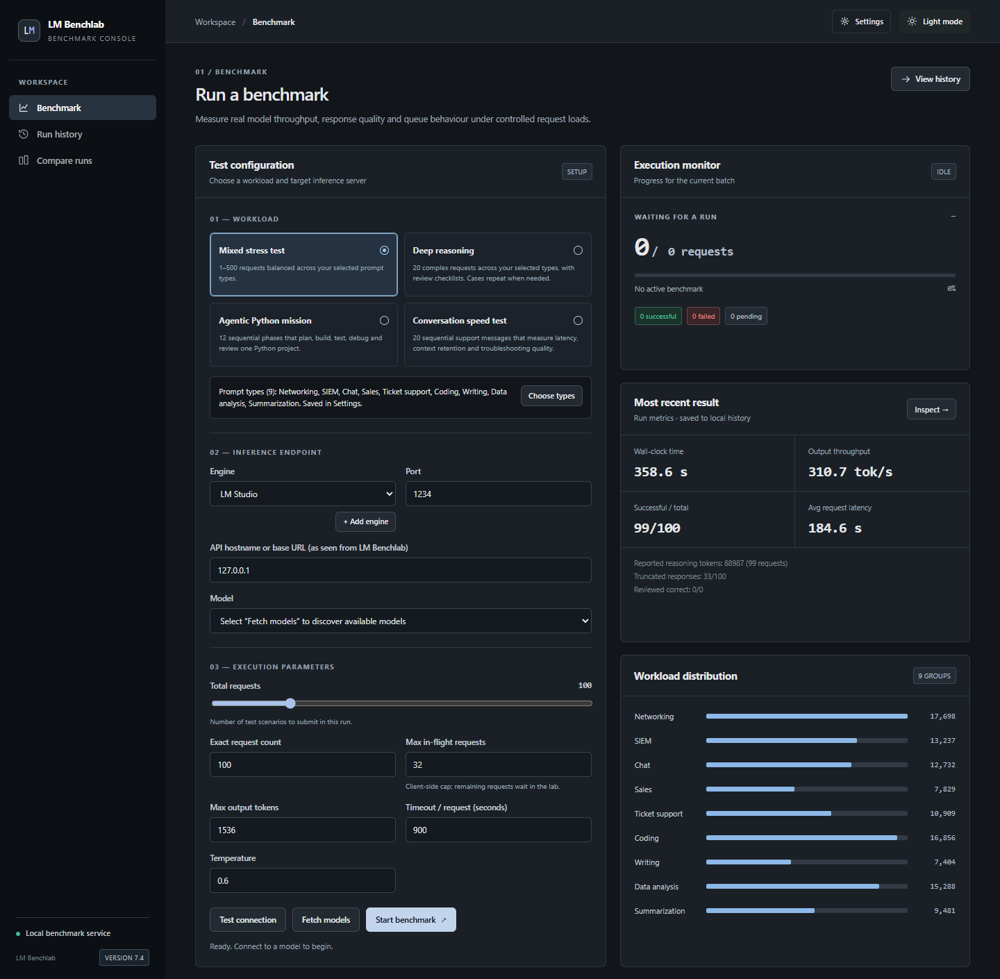
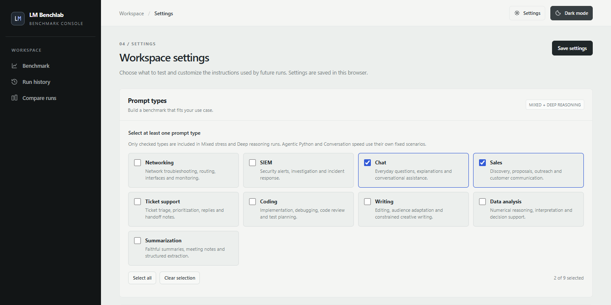
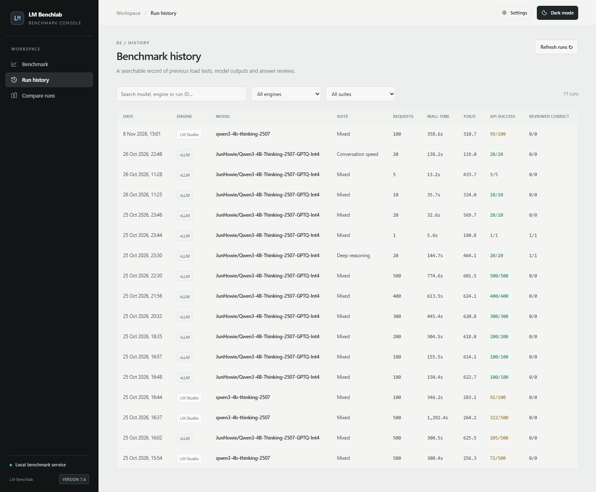
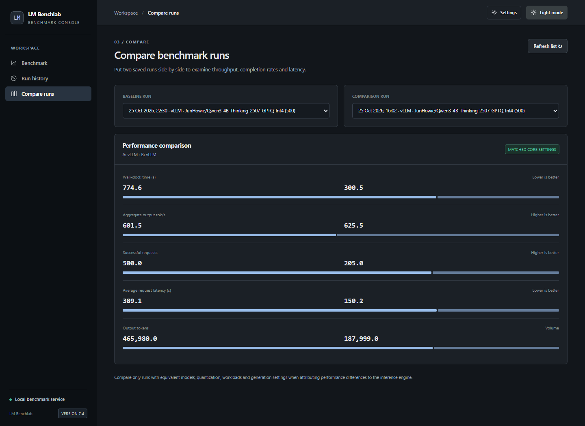

<p align="center">
  
</p>

<h1 align="center">LM Benchlab</h1>

<p align="center">
  <strong>Put your language models through their paces.</strong><br>
  A local dashboard for testing speed, reviewing answers and comparing workloads.
</p>

<p align="center">
  
  
  
  
</p>

<p align="center">
  <a href="#quick-start">Quick start</a> ·
  <a href="#prompt-types">Prompt types</a> ·
  <a href="#benchmark-suites">Test suites</a> ·
  <a href="#screenshots">Screenshots</a> ·
  <a href="docs/configuration.md">Configuration</a> ·
  <a href="docs/operations.md">History &amp; upgrades</a>
</p>

<p align="center">
  <a href="docs/screenshots/benchmark.png">
    
  </a>
</p>

<p align="center"><sub>Configure a workload, run a benchmark and inspect its metrics in one place.</sub></p>

LM Benchlab connects to **LM Studio, vLLM and other OpenAI-compatible inference servers**. Choose the kinds of work you care about, run a benchmark, then inspect the responses alongside throughput and latency. Completed runs are saved in local SQLite history.

## Quick start

With Docker and the Compose plugin installed, run this from the project folder:

```sh
docker compose up -d --build
```

Open **[127.0.0.1:8768](http://127.0.0.1:8768)**, start your inference server and **fetch its models**. Choose a model and test suite, then run your first benchmark.

> [!NOTE]
> LM Benchlab is a local tool without authentication. Keep the dashboard bound to localhost and use synthetic test data. Configured inference and judge servers receive the prompts for a run.

Prefer Python? See the [native installation instructions](docs/configuration.md#native-python). To change the port or default inference host, start with [`.env.example`](.env.example) and the [configuration guide](docs/configuration.md).

## What you can measure

| Capability | What it gives you |
|---|---|
| **Load and latency** | Control request count, maximum in-flight requests, output limits and timeouts; inspect throughput, request latency and token metrics. |
| **Response quality** | Read complete prompts, answers, returned reasoning and errors. Mark answers correct or incorrect, or enable an optional LLM judge. |
| **Workload fit** | Select prompt categories and edit their system instructions to match the work you want to test. |
| **Continuity** | Test multi-turn context retention and a chained Python engineering mission. |
| **History and comparison** | Save completed runs, filter requests, compare saved metrics and export CSV. |

The interface supports light and dark themes. The app runs without a frontend build step, CDN or hosted account.

## Prompt types

Open **Settings → Prompt types**, tick the categories you want and **Save settings**. For example, select **Chat** and **Sales** while leaving **Networking** and **SIEM** unchecked.

| General assistance | Business and communication | Technical workloads |
|---|---|---|
| **Chat**<br>Questions, explanations and conversation | **Sales**<br>Discovery, proposals and outreach | **Coding**<br>Implementation, debugging and review |
| **Writing**<br>Editing, tone and constrained writing | **Ticket support**<br>Triage, replies and handoffs | **Networking**<br>Interfaces, routing and troubleshooting |
| **Summarization**<br>Summaries, notes and extraction | **Data analysis**<br>Calculations and decision support | **SIEM**<br>Security alerts and investigation |

All nine types are enabled initially; at least one must remain selected. Categories apply to **Mixed stress** and **Deep reasoning**. Cases cycle across enabled types, so short runs may not cover every selected type. Saved runs retain their category selection and actual prompts.

## Benchmark suites

| Suite | Requests | What it tests | Uses selected types |
|---|---:|---|:---:|
| **Mixed stress** | 1–500 | Independent prompts under configurable concurrent load | Yes |
| **Deep reasoning** | 20 | Multi-step tasks with review checklists; cases repeat when needed | Yes |
| **Agentic Python mission** | 12 | Sequential planning, implementation, testing and review of one synthetic project | Fixed scenario |
| **Conversation speed** | 20 | A sequential support conversation with accumulated context | Fixed scenario |

Start with a small run and tune settings for your hardware. For meaningful comparisons, keep the model, quantization, prompt categories and generation settings consistent. **An API success does not mean an answer is correct.** Judge scores are review aids, not ground truth.

## Screenshots

<table>
  <tr>
    <th width="50%">Choose your prompt types</th>
    <th width="50%">Revisit saved runs</th>
  </tr>
  <tr>
    <td valign="top">
      <a href="docs/screenshots/prompt-settings.png"></a>
    </td>
    <td valign="top">
      <a href="docs/screenshots/history.png"></a>
    </td>
  </tr>
  <tr>
    <td>Build a workload around the categories you care about.</td>
    <td>Filter runs, inspect answers and keep a record of your tests.</td>
  </tr>
</table>

<details>
<summary><strong>Compare two saved runs</strong></summary>

[](docs/screenshots/compare.png)

Compare throughput, latency, completion and token metrics side by side.

</details>

Click a screenshot to view it full size. Screenshots include saved local runs; values depend on hardware, model and settings.

## Documentation

| Guide | Covers |
|---|---|
| [Installation and configuration](docs/configuration.md) | Docker, native Python, inference connections, environment variables and encrypted engine keys |
| [History, backups and upgrades](docs/operations.md) | Saved runs, persistent storage, rename compatibility and troubleshooting |
| [Security](SECURITY.md) | Local access, stored data, credentials and vulnerability reporting |
| [Contributing](CONTRIBUTING.md) | Development setup and automated checks |

For a quick local check:

```sh
python -m unittest discover -s tests -v
node --test tests/test_frontend.mjs
```

The frontend checks use Node.js 22 or later; Node.js is not required to run the app. [GitHub Actions](.github/workflows/ci.yml) runs Python tests, frontend checks and a Docker build.

A software license still needs to be chosen by the project owner before this repository is offered as open source.
